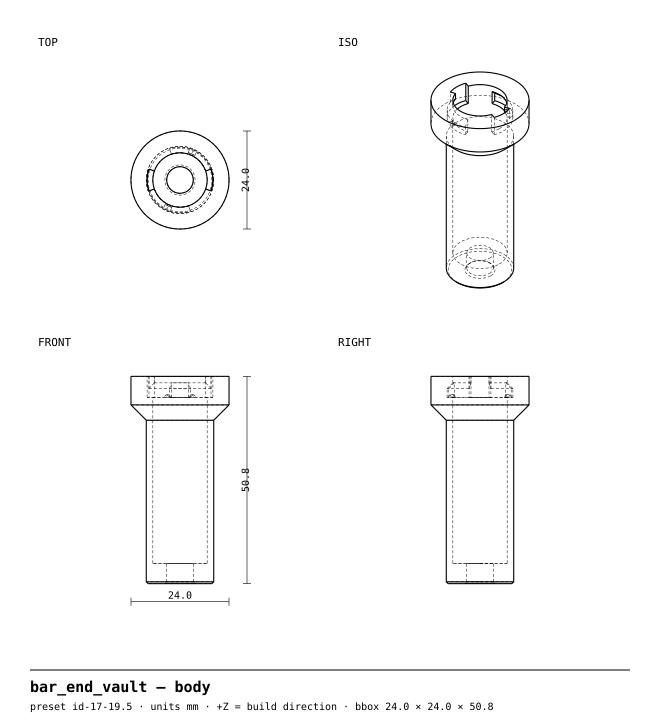
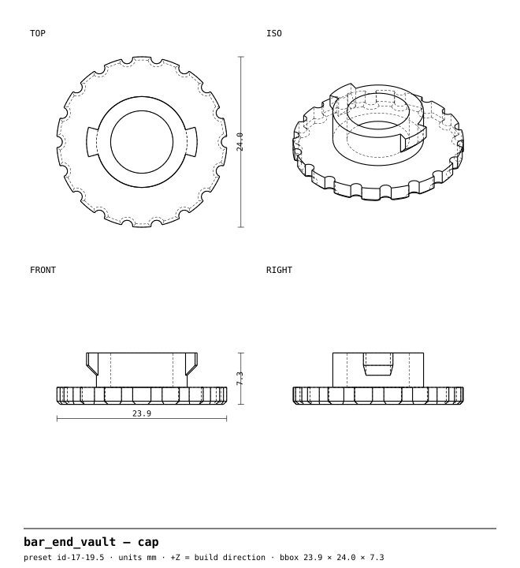
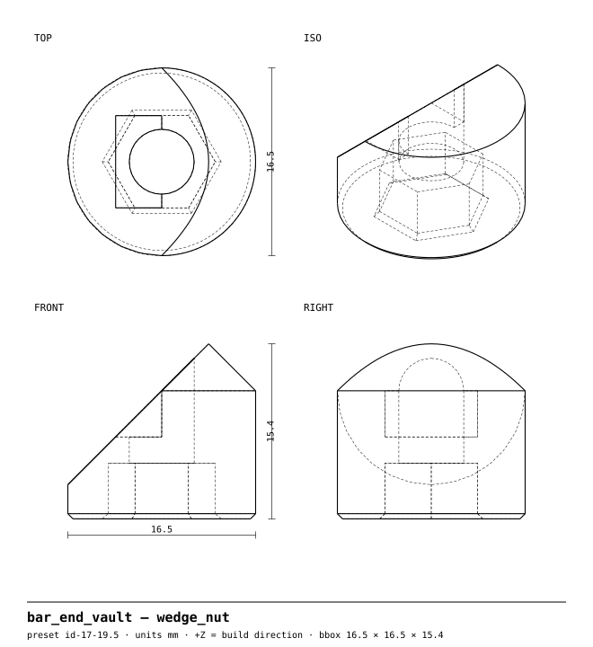
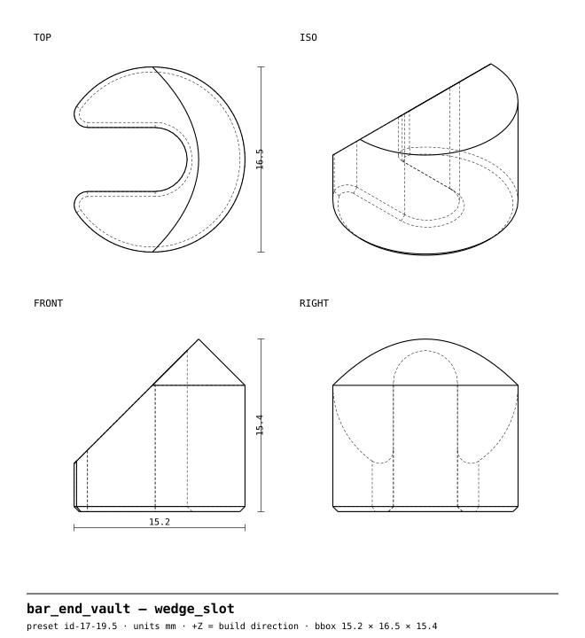

<!-- GENERATED by `uv run build` from part.py / params.py — do not edit by hand. -->
# Vault bar-end plug

**Expanding bar-end plug with a twist-lock core that carries your tubeless repair kit.**

Part 5 of the [bikeparts](https://github.com/neuropathogens/bikeparts) library · recommended material **PETG** · 2 size presets from one source file

> **Accessory only — no warranty.** This part is never in the rider's primary load path; its worst-case failure is losing the accessory, not control of the bike. It has only been designed for PETG printed in the orientation the files come in; **other materials and orientations are untested.** See [status](#validation-status).

## Why

**Problem.** Open bar ends are an injury hazard, push-in plugs fall out, and a tubeless repair kit is useless when it's at home.

**What this does differently.** A stem-style double wedge locks the plug into bars from 17 to 21.5 mm inside diameter (two printed sizes from one source file), and the hollow core behind a quarter-turn bayonet cap holds tubeless plugs and a reamer. No printed threads and no flexing fingers: every printed piece works in compression or in-plane shear.

## Drawings (id-17-19.5)

**body**



**cap**



**wedge_nut**



**wedge_slot**



## Print it

| Setting | Value |
|---|---|
| Material | PETG (Tg ≈ 80 °C, above the 70 °C heat floor) |
| Orientation | as exported — do not rotate |
| Supports | **off** (every part is designed to print without them) |
| Layer height | 0.20 mm |
| Perimeters | 3 (= the 1.2 mm minimum wall) |
| Infill | 30 % gyroid |
| Nozzle / bed | 0.4 mm, fits 220 × 220 mm |
| Profiles | [`profiles/`](../../../../profiles) (PrusaSlicer, generic 220 mm printer) |

**Why this orientation.** Every piece prints with its axis vertical. The body's bayonet groove and lip are rings in the layer plane, so the cap's pull-out load is hoop and in-plane shear. The wedges' 45° faces print facing up and slide on each other in compression.

### Printed parts (id-17-19.5)

| Body | Qty | Material | Size (mm) | Filament | Print time |
|---|---|---|---|---|---|
| `body` | 1 | PETG | 24.0 × 24.0 × 50.8 | 7 g | 42m 18s |
| `cap` | 1 | PETG | 23.9 × 24.0 × 7.3 | 2 g | 11m 39s |
| `wedge_nut` | 1 | PETG | 16.5 × 16.5 × 15.4 | 2 g | 15m 41s |
| `wedge_slot` | 1 | PETG | 15.2 × 16.5 × 15.4 | 2 g | 11m 53s |

Grams and time from the PrusaSlicer CLI with the profiles above on a generic, conservatively-tuned 220 mm printer; fast printers will be quicker.

### Files

STEP (editable in Fusion/FreeCAD/Onshape), STL and 3MF for every preset are built by CI on every commit (download the `out` artifact from the latest run under **Actions**) or locally:

```sh
uv run build --part bar_end_vault     # → out/bar_end_vault/<preset>/<body>.step|stl|3mf|svg
```

## Hardware

- 1 × M5 × 30 socket head cap screw (ISO 4762)
- 1 × M5 hex nut (ISO 4032)
- 1 × M5 plain washer, Ø10 (ISO 7089 / DIN 125-A)

## Assembly

1. Press the M5 nut into the hex pocket on the flat end of `wedge_nut`.
2. Drop the washer and bolt into the body's core so the bolt pokes out of the inboard end.
3. Slide `wedge_slot` sideways onto the bolt (it has an open notch), flat face against the body. Thread the bolt into `wedge_nut` with its slope facing `wedge_slot`: the two slopes mate into one cylinder.
4. Turn the bolt until the stack holds together but is still the tube's diameter.
5. Slide the plug into the bar until the cone seats on the bar end.
6. Tighten with a long-arm 4 mm hex key through the core to 0.5 N·m — snug, fingertip force on a short hex key. The wedges slide apart and lock against the bar wall. More torque does not hold better; it crushes the plastic.
7. Fill the core (tubeless plugs, a reamer, a quick link) and twist the cap on a quarter turn until it clicks past the detent.

## Presets

<details open><summary><b>id-17-19.5</b> — 13 g</summary>

| | |
|---|---|
| Fits bar inner diameter | 17–19.5 mm |
| Insertion depth | 62.5 mm (body 40 + wedge stack 22.5) |
| Storage core | Ø13.3 × 41 mm (above the bolt head) |
| Bolt torque | 0.5 N·m (preload ≈ 500 N) |
| Hand check at design torque | washer punch-through 3.2 MPa (SF 3.5); nut pull-through 2.8 MPa (SF 4.0); allowable 11.2 MPa (unverified PETG values) |
| Hand check at Gate 3 over-torque (+25 %) | SF 2.8 floor, 3.2 nut |

| Body | Qty | Size (mm) | Filament | Time |
|---|---|---|---|---|
| `body` | 1 | 24.0 × 24.0 × 50.8 | 7 g | 42m 18s |
| `cap` | 1 | 23.9 × 24.0 × 7.3 | 2 g | 11m 39s |
| `wedge_nut` | 1 | 16.5 × 16.5 × 15.4 | 2 g | 15m 41s |
| `wedge_slot` | 1 | 15.2 × 16.5 × 15.4 | 2 g | 11m 53s |

</details>

<details><summary><b>id-19-21.5</b> — 15 g</summary>

| | |
|---|---|
| Fits bar inner diameter | 19–21.5 mm |
| Insertion depth | 64.5 mm (body 40 + wedge stack 24.5) |
| Storage core | Ø15.3 × 41 mm (above the bolt head) |
| Bolt torque | 0.5 N·m (preload ≈ 500 N) |
| Hand check at design torque | washer punch-through 3.2 MPa (SF 3.5); nut pull-through 2.4 MPa (SF 4.7); allowable 11.2 MPa (unverified PETG values) |
| Hand check at Gate 3 over-torque (+25 %) | SF 2.8 floor, 3.7 nut |

| Body | Qty | Size (mm) | Filament | Time |
|---|---|---|---|---|
| `body` | 1 | 26.0 × 26.0 × 50.8 | 8 g | 49m 20s |
| `cap` | 1 | 26.0 × 26.0 × 7.3 | 2 g | 12m 35s |
| `wedge_nut` | 1 | 18.5 × 18.5 × 16.9 | 2 g | 17m 46s |
| `wedge_slot` | 1 | 17.4 × 18.5 × 16.9 | 2 g | 14m 36s |

Hardware: 1 × M5 × 35 socket head cap screw (ISO 4762); 1 × M5 hex nut (ISO 4032); 1 × M5 plain washer, Ø10 (ISO 7089 / DIN 125-A)

</details>

## Validation status

| Gate | Status |
|---|---|
| 1 — automated geometry checks | ✅ all presets pass (table below) |
| 2 — FEA | Gate 2 applies (part 5). FEA pipeline is Phase 3 and has not run. The hand check in the facts table covers bolt preload only; impact on the bar end is untested. |
| 3 — physical test | **Not yet tested.** Results will go in [`test-reports/bar_end_vault/`](../../../../test-reports). |

### Gate 1 results

| Preset / body | watertight | bed_fit | overhang | min_wall | hole_orientation |
|---|---|---|---|---|---|
| id-17-19.5 / `body` | ✅ pass | ✅ pass | ✅ pass | ✅ pass | ✅ pass |
| id-17-19.5 / `cap` | ✅ pass | ✅ pass | ✅ pass | ✅ pass | ✅ pass |
| id-17-19.5 / `wedge_nut` | ✅ pass | ✅ pass | ✅ pass | ✅ pass | ✅ pass |
| id-17-19.5 / `wedge_slot` | ✅ pass | ✅ pass | ✅ pass | ✅ pass | ✅ pass |
| id-19-21.5 / `body` | ✅ pass | ✅ pass | ✅ pass | ✅ pass | ✅ pass |
| id-19-21.5 / `cap` | ✅ pass | ✅ pass | ✅ pass | ✅ pass | ✅ pass |
| id-19-21.5 / `wedge_nut` | ✅ pass | ✅ pass | ✅ pass | ✅ pass | ✅ pass |
| id-19-21.5 / `wedge_slot` | ✅ pass | ✅ pass | ✅ pass | ✅ pass | ✅ pass |

### Gate 3 tests to run

Print in the recommended material with the `profiles/`. Paint-mark every bolt head first.

| Test | Method | Pass criterion | Result |
|---|---|---|---|
| Bolt torque | Torque to spec + 25% with a torque wrench | No cracks, no insert pull-out | pending |
| Heat soak | 1 hr at 70 °C (oven or car dash), then re-torque check | Fit holds, no warp, bolts still at torque | pending |
| Ride vibration | 50 km including gravel or rough pavement | Paint marks unbroken, nothing loose or rattling | pending |
| Drop | Bike dropped onto its side from upright, 3× per side | Part intact; accessory retained or caught by tether | pending |

## Assumptions to verify

- Bar ends are round inside and 17–21.5 mm across; internal routing ports sit deeper than ~70 mm.
- 0.5 N·m (≈ 500 N preload, ~150 N friction at μ ≈ 0.3) is enough to hold the plug; Gate 3 tests will confirm.
- The cap detent (bump 0.1 mm taller than the lug's play) gives a click on a printer close to the default tolerances; tune `detent_interference` if the cap is too loose or too stiff.

Material strengths in `core/materials.py` are typical values, not your filament's datasheet, until someone enters and verifies them.

## License

Design files CERN-OHL-S-2.0 · code Apache-2.0 · this README and drawings CC BY-SA 4.0. See [LICENSE.md](../../../../LICENSE.md). Compatibility names (e.g. AirTag) describe fit only; this project isn't affiliated with any brand.
