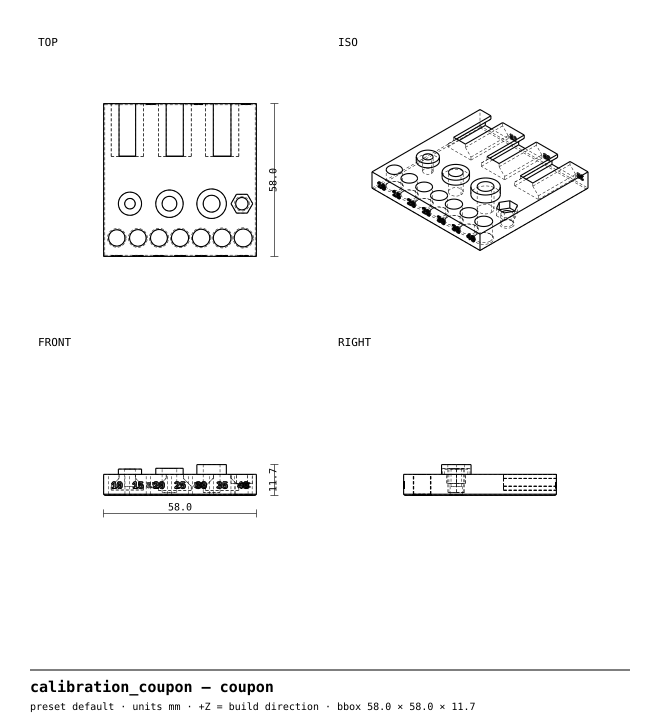
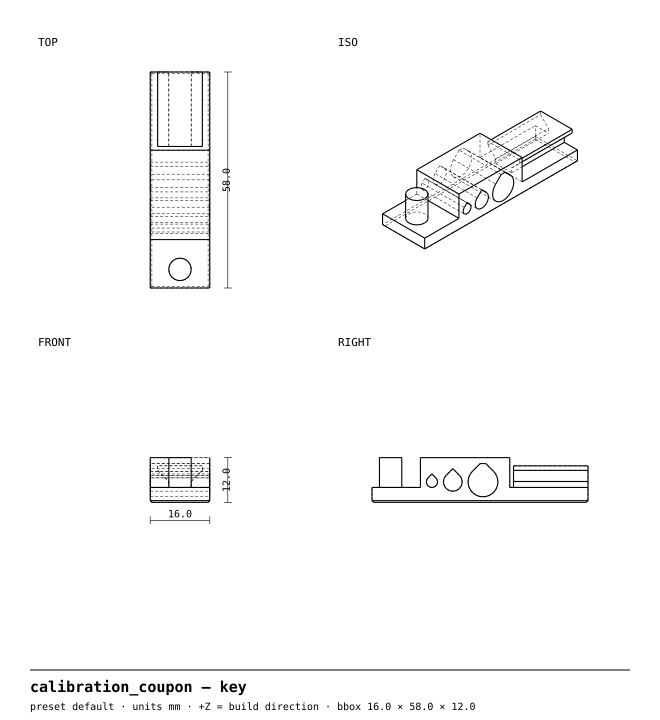

<!-- GENERATED by `uv run build` from part.py / params.py — do not edit by hand. -->
# Calibration coupon

**One 58 mm print that measures your printer's real fits, so every part fits.**

Part 0 of the [bikeparts](https://github.com/neuropathogens/bikeparts) library · recommended material **PETG** · 1 size presets from one source file

> **Accessory only — no warranty.** This part is never in the rider's primary load path; its worst-case failure is losing the accessory, not control of the bike. It has only been designed for PETG printed in the orientation the files come in; **other materials and orientations are untested.** See [status](#validation-status).

## Why

**Problem.** Every printer and filament prints holes a little small and pegs a little big. Clearances guessed for someone else's printer make press fits loose and slides stick.

**What this does differently.** Each fit the library uses — sliding, press, captive nut, heat-set insert, horizontal teardrop hole, dovetail rail — on one small plate with a matching key. You write down what fits; `uv run calibrate` writes it into `core/tolerances.py` and every part regenerates with your printer's numbers.

## Drawings (default)

**coupon**



**key**



## Print it

| Setting | Value |
|---|---|
| Material | PETG (Tg ≈ 80 °C, above the 70 °C heat floor) |
| Orientation | as exported — do not rotate |
| Supports | **off** (every part is designed to print without them) |
| Layer height | 0.20 mm |
| Perimeters | 3 (= the 1.2 mm minimum wall) |
| Infill | 30 % gyroid |
| Nozzle / bed | 0.4 mm, fits 220 × 220 mm |
| Profiles | [`profiles/`](../../../../profiles) (PrusaSlicer, generic 220 mm printer) |

**Why this orientation.** Flat on the bed, like the parts it calibrates: holes vertical, teardrops horizontal, dovetail undercuts at the 45° limit.

### Printed parts (default)

| Body | Qty | Material | Size (mm) | Filament | Print time |
|---|---|---|---|---|---|
| `coupon` | 1 | PETG | 58.0 × 58.0 × 11.7 | 19 g | 1h 58m 23s |
| `key` | 1 | PETG | 16.0 × 58.0 × 12.0 | 7 g | 44m 32s |

Grams and time from the PrusaSlicer CLI with the profiles above on a generic, conservatively-tuned 220 mm printer; fast printers will be quicker.

### Files

STEP (editable in Fusion/FreeCAD/Onshape), STL and 3MF for every preset are built by CI on every commit (download the `out` artifact from the latest run under **Actions**) or locally:

```sh
uv run build --part calibration_coupon     # → out/calibration_coupon/<preset>/<body>.step|stl|3mf|svg
```

## Hardware

- 1 each of the heat-set inserts you'll use: M3, M4, M5
- 1 × M4 hex nut, 1 × M4 bolt (any length ≥ 10 mm)
- Calipers; drill bits or pin gauges of 3, 5 and 8 mm

## Assembly

1. Holes (10, 15, 20, 25, 30, 35, 40, hundredths of a mm per side): push the key's Ø6 peg through each hole, smallest first. Note the smallest hole it slides through freely by hand (**sliding fit**) and the smallest it can be pressed into firmly with your thumb (**press fit**).
2. Dovetails (15 / 25 / 35): slide the key's rail into each slot from the back edge. Note the tightest one that slides the full length without forcing (**dovetail**).
3. Nut: press the M4 nut into the hex pocket. Note **tight** (needs a tap), **good** (firm push, stays put upside-down) or **loose** (falls out).
4. Inserts: install each insert with a soldering iron. Note whether it went in **straight** and flush, **tight** (bulged plastic, crooked) or **loose** (spins with a bolt in it).
5. Teardrop holes: try 3, 5 and 8 mm drill shanks (or pin gauges) in the key's block. Measure the round part of each hole with calipers if a shank won't go.
6. Fill in the form below, then run `uv run calibrate` with your numbers.

## Presets

<details open><summary><b>default</b> — 26 g</summary>

| | |
|---|---|
| Hole ladder | Ø6 + 2 × (10, 15, 20, 25, 30, 35, 40) / 100 mm |
| Dovetail fits | 0.15, 0.25, 0.35 mm per side |
| Current tolerances.py | sliding 0.25, press 0.05, nut +0.15, bolt holes +0.1, inserts +0.0 |

| Body | Qty | Size (mm) | Filament | Time |
|---|---|---|---|---|
| `coupon` | 1 | 58.0 × 58.0 × 11.7 | 19 g | 1h 58m 23s |
| `key` | 1 | 16.0 × 58.0 × 12.0 | 7 g | 44m 32s |

</details>

## Validation status

| Gate | Status |
|---|---|
| 1 — automated geometry checks | ✅ all presets pass (table below) |
| 2 — FEA | Not required (no clamp or hanging load). |
| 3 — physical test | **Not yet tested.** Results will go in [`test-reports/calibration_coupon/`](../../../../test-reports). |

### Gate 1 results

| Preset / body | watertight | bed_fit | overhang | min_wall | hole_orientation |
|---|---|---|---|---|---|
| default / `coupon` | ✅ pass | ✅ pass | ✅ pass | ✅ pass | ✅ pass |
| default / `key` | ✅ pass | ✅ pass | ✅ pass | ✅ pass | ✅ pass |

### Rule exceptions

- Label region excluded from overhang/min_wall: rule 7: '10' debossed 0.4 mm on a vertical face
- Label region excluded from overhang/min_wall: rule 7: '15' debossed 0.4 mm on a vertical face
- Label region excluded from overhang/min_wall: rule 7: '20' debossed 0.4 mm on a vertical face
- Label region excluded from overhang/min_wall: rule 7: '25' debossed 0.4 mm on a vertical face
- Label region excluded from overhang/min_wall: rule 7: '30' debossed 0.4 mm on a vertical face
- Label region excluded from overhang/min_wall: rule 7: '35' debossed 0.4 mm on a vertical face
- Label region excluded from overhang/min_wall: rule 7: '40' debossed 0.4 mm on a vertical face

## Measurement form

Copy this into `test-reports/calibration_coupon/<date>-<printer>.md`, fill it in, then run
the command at the bottom.

```
Printer:                Filament (brand, type):         Date:
Sliding fit (smallest free hole):   0.__   (hundredths → mm per side)
Press fit (smallest firm-press hole): 0.__
Dovetail (tightest full-length slide): 0.__
M4 nut in pocket:        tight / good / loose
Inserts M3 / M4 / M5:    straight / tight / loose   (each)
Teardrop 3 / 5 / 8:      measured Ø __ / __ / __    (round part, calipers)
```

```sh
uv run calibrate --sliding 0.20 --press 0.10 --nut good --inserts straight \
                 --holes 3=2.86,5=4.88,8=7.90 --printer "Prusa MK4, Prusament PETG"
uv run calibrate --help    # what each option does; --dry-run shows the change first
```

The dovetail result sets the sliding fit for rails if it differs from the peg's; the
calibrate script reports it but rails use `sliding_fit` until a part needs otherwise.

Material strengths in `core/materials.py` are typical values, not your filament's datasheet, until someone enters and verifies them.

## License

Design files CERN-OHL-S-2.0 · code Apache-2.0 · this README and drawings CC BY-SA 4.0. See [LICENSE.md](../../../../LICENSE.md). Compatibility names (e.g. AirTag) describe fit only; this project isn't affiliated with any brand.
