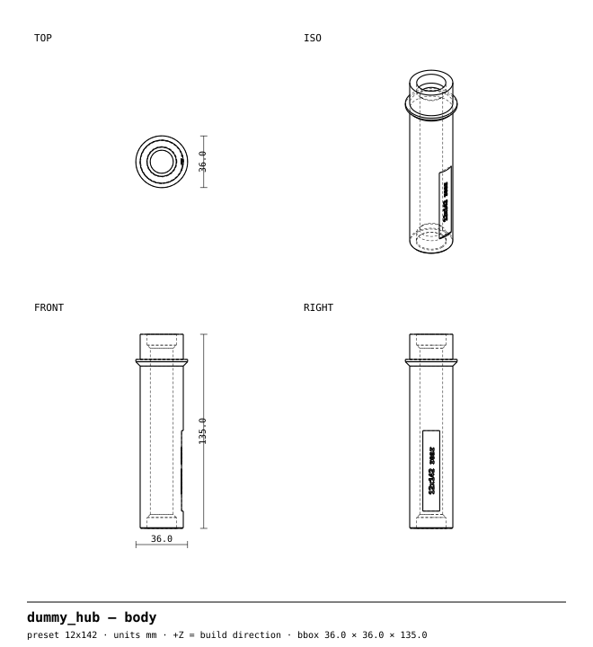
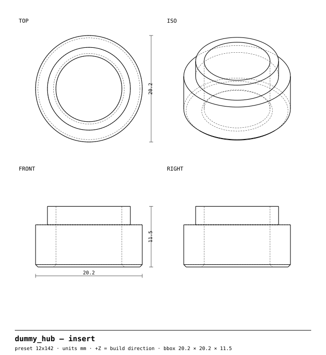
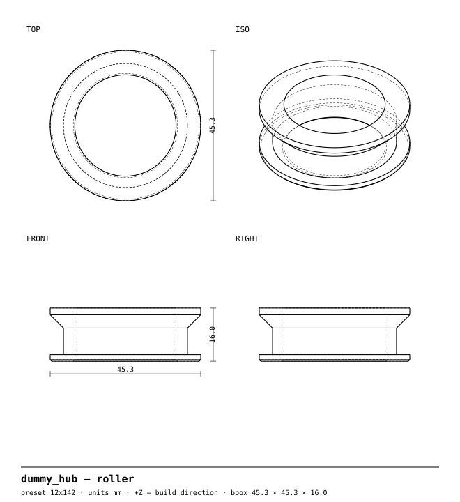

<!-- GENERATED by `uv run build` from part.py / params.py — do not edit by hand. -->
# Shop dummy hub

**Shipping spacer and chain keeper in one: holds the dropouts and spins the chain.**

Part 3 of the [bikeparts](https://github.com/neuropathogens/bikeparts) library · recommended material **PETG** · 8 size presets from one source file

> **Accessory only — no warranty.** This part is never in the rider's primary load path; its worst-case failure is losing the accessory, not control of the bike. It has only been designed for PETG printed in the orientation the files come in; **other materials and orientations are untested.** See [status](#validation-status).

## Why

**Problem.** Bikes shipped without wheels get crushed fork blades and bent rear triangles, and with the rear wheel out the chain flops, grinds the frame and can't be cleaned.

**What this does differently.** One parametric body per axle standard, clamped by the bike's own skewer or thru-axle, so it's exactly hub-width and can't fall out in the box. Rear versions carry a free-spinning roller where the smallest cog sits: backpedal to wash the chain with the wheel out, and the derailleur stays tensioned in transit. Swap-in end inserts carry the axle-specific detail; the standard is debossed on the body and each standard gets its own filament colour.

## Drawings (12x142)

**body**



**insert**



**roller**



## Print it

| Setting | Value |
|---|---|
| Material | PETG (Tg ≈ 80 °C, above the 70 °C heat floor) |
| Orientation | as exported — do not rotate |
| Supports | **off** (every part is designed to print without them) |
| Layer height | 0.20 mm |
| Perimeters | 3 (= the 1.2 mm minimum wall) |
| Infill | 30 % gyroid |
| Nozzle / bed | 0.4 mm, fits 220 × 220 mm |
| Profiles | [`profiles/`](../../../../profiles) (PrusaSlicer, generic 220 mm printer) |

**Why this orientation.** The body prints standing up so the dropout clamp and shipping crush load run along the build axis, where layers simply press together. The roller and inserts print flat on their faces; every overhang is a 45° cone.

- `body`: Tall and slim: print with the 5 mm brim (set automatically in the slice).

### Printed parts (12x142)

| Body | Qty | Material | Size (mm) | Filament | Print time |
|---|---|---|---|---|---|
| `body` | 1 | PETG | 36.0 × 36.0 × 135.0 | 51 g | 5h 1m 21s |
| `insert` | 2 | PETG | 20.2 × 20.2 × 11.5 | 4 g | 13m 14s (× 2) |
| `roller` | 1 | PETG | 45.3 × 45.3 × 16.0 | 10 g | 53m 21s |

Grams and time from the PrusaSlicer CLI with the profiles above on a generic, conservatively-tuned 220 mm printer; fast printers will be quicker.

### Files

STEP (editable in Fusion/FreeCAD/Onshape), STL and 3MF for every preset are built by CI on every commit (download the `out` artifact from the latest run under **Actions**) or locally:

```sh
uv run build --part dummy_hub     # → out/dummy_hub/<preset>/<body>.step|stl|3mf|svg
```

## Hardware

- None: uses the bike's own skewer or thru-axle.

## Assembly

1. Press an insert into each end of the body (stub facing out) until it stops on the internal cone. A vise or a tap with a mallet does it.
2. Slide the roller onto the drive-side end, the flat flange face outward, so it rests on the collar. It should spin freely.
3. Remove the wheel. Rear: shift to the smallest cog first.
4. Set the dummy hub in the dropouts with the roller on the drive side and the chain over the roller.
5. Clamp it with the bike's own thru-axle at normal closing force.
6. Backpedal: the chain runs on the roller like a cog, so you can wash and lube it.

## Presets

<details open><summary><b>12x142</b> — 65 g</summary>

| | |
|---|---|
| Axle standard | 12×142 rear |
| Body length (dropout to dropout) | 135 mm |
| Insert | end-cap stub 3.5 mm into the dropout recess, bore Ø12.5 |
| Chain roller | seat Ø37.3 (an 11T cog's root circle), groove 8 mm, centred ~7 mm inboard of the drive dropout |
| Check first | inner dropout spacing should be 135 mm (142 − 2 × 3.5 mm end-cap recesses) — UNVERIFIED, measure one frame before printing a batch |

| Body | Qty | Size (mm) | Filament | Time |
|---|---|---|---|---|
| `body` | 1 | 36.0 × 36.0 × 135.0 | 51 g | 5h 1m 21s |
| `insert` | 2 | 20.2 × 20.2 × 11.5 | 4 g | 13m 14s (× 2) |
| `roller` | 1 | 45.3 × 45.3 × 16.0 | 10 g | 53m 21s |

</details>

<details><summary><b>12x148</b> — 67 g</summary>

| | |
|---|---|
| Axle standard | 12×148 rear (Boost) |
| Body length (dropout to dropout) | 141 mm |
| Insert | end-cap stub 3.5 mm into the dropout recess, bore Ø12.5 |
| Chain roller | seat Ø37.3 (an 11T cog's root circle), groove 8 mm, centred ~7 mm inboard of the drive dropout |
| Check first | inner dropout spacing should be 141 mm (148 − 2 × 3.5 mm end-cap recesses) — UNVERIFIED, measure one frame before printing a batch |

| Body | Qty | Size (mm) | Filament | Time |
|---|---|---|---|---|
| `body` | 1 | 36.0 × 36.0 × 141.0 | 54 g | 5h 15m 11s |
| `insert` | 2 | 20.2 × 20.2 × 11.5 | 4 g | 13m 14s (× 2) |
| `roller` | 1 | 45.3 × 45.3 × 16.0 | 10 g | 53m 21s |

</details>

<details><summary><b>qr130</b> — 64 g</summary>

| | |
|---|---|
| Axle standard | QR 130 rear (road) |
| Body length (dropout to dropout) | 130 mm |
| Insert | QR stub Ø9.6 × 3 mm, bore Ø5.5 for the skewer |
| Chain roller | seat Ø37.3 (an 11T cog's root circle), groove 8 mm, centred ~7 mm inboard of the drive dropout |

| Body | Qty | Size (mm) | Filament | Time |
|---|---|---|---|---|
| `body` | 1 | 36.0 × 36.0 × 130.0 | 49 g | 4h 50m 5s |
| `insert` | 2 | 20.2 × 20.2 × 11.0 | 4 g | 15m 35s (× 2) |
| `roller` | 1 | 45.3 × 45.3 × 16.0 | 10 g | 53m 21s |

</details>

<details><summary><b>qr135</b> — 65 g</summary>

| | |
|---|---|
| Axle standard | QR 135 rear (MTB) |
| Body length (dropout to dropout) | 135 mm |
| Insert | QR stub Ø9.6 × 3 mm, bore Ø5.5 for the skewer |
| Chain roller | seat Ø37.3 (an 11T cog's root circle), groove 8 mm, centred ~7 mm inboard of the drive dropout |

| Body | Qty | Size (mm) | Filament | Time |
|---|---|---|---|---|
| `body` | 1 | 36.0 × 36.0 × 135.0 | 51 g | 5h 1m 44s |
| `insert` | 2 | 20.2 × 20.2 × 11.0 | 4 g | 15m 35s (× 2) |
| `roller` | 1 | 45.3 × 45.3 × 16.0 | 10 g | 53m 21s |

</details>

<details><summary><b>qr100</b> — 42 g</summary>

| | |
|---|---|
| Axle standard | QR 100 front |
| Body length (dropout to dropout) | 100 mm |
| Insert | QR stub Ø8.6 × 3 mm, bore Ø5.5 for the skewer |

| Body | Qty | Size (mm) | Filament | Time |
|---|---|---|---|---|
| `body` | 1 | 30.0 × 30.0 × 100.0 | 37 g | 3h 40m 24s |
| `insert` | 2 | 20.2 × 20.2 × 11.0 | 4 g | 15m 4s (× 2) |

</details>

<details><summary><b>12x100</b> — 41 g</summary>

| | |
|---|---|
| Axle standard | 12×100 front |
| Body length (dropout to dropout) | 100 mm |
| Insert | flush bushing, bore Ø12.5 |

| Body | Qty | Size (mm) | Filament | Time |
|---|---|---|---|---|
| `body` | 1 | 30.0 × 30.0 × 100.0 | 37 g | 3h 40m 29s |
| `insert` | 2 | 20.2 × 20.2 × 8.0 | 4 g | 10m 56s (× 2) |

</details>

<details><summary><b>15x100</b> — 40 g</summary>

| | |
|---|---|
| Axle standard | 15×100 front |
| Body length (dropout to dropout) | 100 mm |
| Insert | flush bushing, bore Ø15.5 |

| Body | Qty | Size (mm) | Filament | Time |
|---|---|---|---|---|
| `body` | 1 | 30.0 × 30.0 × 100.0 | 37 g | 3h 40m 26s |
| `insert` | 2 | 20.2 × 20.2 × 8.0 | 3 g | 7m 36s (× 2) |

</details>

<details><summary><b>15x110</b> — 44 g</summary>

| | |
|---|---|
| Axle standard | 15×110 front (Boost) |
| Body length (dropout to dropout) | 110 mm |
| Insert | flush bushing, bore Ø15.5 |

| Body | Qty | Size (mm) | Filament | Time |
|---|---|---|---|---|
| `body` | 1 | 30.0 × 30.0 × 110.0 | 41 g | 4h 2m 15s |
| `insert` | 2 | 20.2 × 20.2 × 8.0 | 3 g | 7m 36s (× 2) |

</details>

## Validation status

| Gate | Status |
|---|---|
| 1 — automated geometry checks | ✅ all presets pass (table below) |
| 2 — FEA | Not required (no clamp or hanging load). |
| 3 — physical test | **Not yet tested.** Results will go in [`test-reports/dummy_hub/`](../../../../test-reports). |

### Gate 1 results

| Preset / body | watertight | bed_fit | overhang | min_wall | hole_orientation |
|---|---|---|---|---|---|
| 12x142 / `body` | ✅ pass | ✅ pass | ✅ pass | ✅ pass | ✅ pass |
| 12x142 / `insert` | ✅ pass | ✅ pass | ✅ pass | ✅ pass | ✅ pass |
| 12x142 / `roller` | ✅ pass | ✅ pass | ✅ pass | ✅ pass | ✅ pass |
| 12x148 / `body` | ✅ pass | ✅ pass | ✅ pass | ✅ pass | ✅ pass |
| 12x148 / `insert` | ✅ pass | ✅ pass | ✅ pass | ✅ pass | ✅ pass |
| 12x148 / `roller` | ✅ pass | ✅ pass | ✅ pass | ✅ pass | ✅ pass |
| qr130 / `body` | ✅ pass | ✅ pass | ✅ pass | ✅ pass | ✅ pass |
| qr130 / `insert` | ✅ pass | ✅ pass | ✅ pass | ✅ pass | ✅ pass |
| qr130 / `roller` | ✅ pass | ✅ pass | ✅ pass | ✅ pass | ✅ pass |
| qr135 / `body` | ✅ pass | ✅ pass | ✅ pass | ✅ pass | ✅ pass |
| qr135 / `insert` | ✅ pass | ✅ pass | ✅ pass | ✅ pass | ✅ pass |
| qr135 / `roller` | ✅ pass | ✅ pass | ✅ pass | ✅ pass | ✅ pass |
| qr100 / `body` | ✅ pass | ✅ pass | ✅ pass | ✅ pass | ✅ pass |
| qr100 / `insert` | ✅ pass | ✅ pass | ✅ pass | ✅ pass | ✅ pass |
| 12x100 / `body` | ✅ pass | ✅ pass | ✅ pass | ✅ pass | ✅ pass |
| 12x100 / `insert` | ✅ pass | ✅ pass | ✅ pass | ✅ pass | ✅ pass |
| 15x100 / `body` | ✅ pass | ✅ pass | ✅ pass | ✅ pass | ✅ pass |
| 15x100 / `insert` | ✅ pass | ✅ pass | ✅ pass | ✅ pass | ✅ pass |
| 15x110 / `body` | ✅ pass | ✅ pass | ✅ pass | ✅ pass | ✅ pass |
| 15x110 / `insert` | ✅ pass | ✅ pass | ✅ pass | ✅ pass | ✅ pass |

### Rule exceptions

- Label region excluded from overhang/min_wall: rule 7: '12x100 front' debossed 0.4 mm on a vertical face
- Label region excluded from overhang/min_wall: rule 7: '12x142 rear' debossed 0.4 mm on a vertical face
- Label region excluded from overhang/min_wall: rule 7: '12x148 rear' debossed 0.4 mm on a vertical face
- Label region excluded from overhang/min_wall: rule 7: '15x100 front' debossed 0.4 mm on a vertical face
- Label region excluded from overhang/min_wall: rule 7: '15x110 front' debossed 0.4 mm on a vertical face
- Label region excluded from overhang/min_wall: rule 7: 'QR 100 front' debossed 0.4 mm on a vertical face
- Label region excluded from overhang/min_wall: rule 7: 'QR 130 rear' debossed 0.4 mm on a vertical face
- Label region excluded from overhang/min_wall: rule 7: 'QR 135 rear' debossed 0.4 mm on a vertical face

### Gate 3 tests to run

Print in the recommended material with the `profiles/`. Paint-mark every bolt head first.

| Test | Method | Pass criterion | Result |
|---|---|---|---|
| Shipping compression | 50 kg static load on spacer for 24 hr | Under 0.5 mm permanent set | pending |
| Heat soak | 1 hr at 70 °C (oven or car dash), then re-torque check | Fit holds, no warp, bolts still at torque | pending |

## Assumptions to verify

- 12×142 and 12×148 frames have 3.5 mm end-cap recesses, so the body is 135 / 141 mm between dropouts. UNVERIFIED: measure a frame before printing a batch.
- QR axle ends are Ø9 (front) / Ø10 (rear) and dropouts are thicker than the 3 mm stub.
- The smallest cog's chainline is ~7 mm inboard of the drive dropout.
- PETG-on-PETG bushing is fine for hand-speed backpedalling; it is not a bearing.

Material strengths in `core/materials.py` are typical values, not your filament's datasheet, until someone enters and verifies them.

## License

Design files CERN-OHL-S-2.0 · code Apache-2.0 · this README and drawings CC BY-SA 4.0. See [LICENSE.md](../../../../LICENSE.md). Compatibility names (e.g. AirTag) describe fit only; this project isn't affiliated with any brand.
