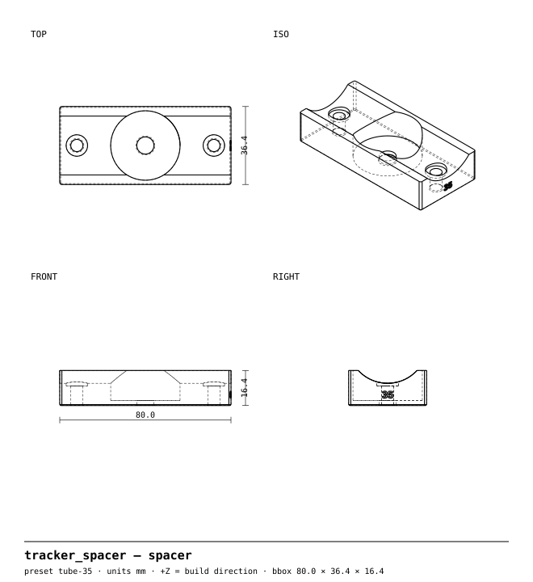
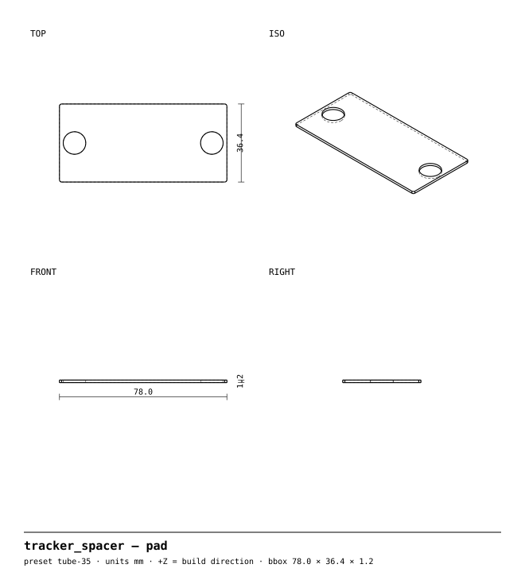

<!-- GENERATED by `uv run build` from part.py / params.py — do not edit by hand. -->
# Ghost tracker spacer

**Hides an AirTag between your frame and bottle cage, out of sight and out of reach.**

Part 2 of the [bikeparts](https://github.com/neuropathogens/bikeparts) library · recommended material **PETG** · 6 size presets from one source file

> **Accessory only — no warranty.** This part is never in the rider's primary load path; its worst-case failure is losing the accessory, not control of the bike. It has only been designed for PETG printed in the orientation the files come in; **other materials and orientations are untested.** See [status](#validation-status).

## Why

**Problem.** Visible trackers get ripped off, and the clever hiding spots (steerer, seat tube) are expensive or touch safety parts.

**What this does differently.** An 11 mm spacer that sits under the bottle cage on the standard 64 mm bosses. The AirTag pocket faces the frame, so the tag is sealed between spacer and tube — a thief has to remove the cage and the spacer to find it, and nothing shows from outside.

## Drawings (tube-35)

**spacer**



**pad**



## Print it

| Setting | Value |
|---|---|
| Material | PETG (Tg ≈ 80 °C, above the 70 °C heat floor) |
| Orientation | as exported — do not rotate |
| Supports | **off** (every part is designed to print without them) |
| Layer height | 0.20 mm |
| Perimeters | 3 (= the 1.2 mm minimum wall) |
| Infill | 30 % gyroid |
| Nozzle / bed | 0.4 mm, fits 220 × 220 mm |
| Profiles | [`profiles/`](../../../../profiles) (PrusaSlicer, generic 220 mm printer) |

**Why this orientation.** Cage face on the bed, saddle up. The spacer is loaded in compression between cage and tube, across the layers, which is the direction layers are strong in. Every hole is vertical and the saddle is an open valley, so it needs no supports.

- `pad`: Optional. No TPU? Use a 1 mm adhesive rubber or felt pad cut to the same shape.

### Printed parts (tube-35)

| Body | Qty | Material | Size (mm) | Filament | Print time |
|---|---|---|---|---|---|
| `spacer` | 1 | PETG | 80.0 × 36.4 × 16.4 | 22 g | 2h 11m 7s |
| `pad` (optional) | 1 | TPU 95A | 78.0 × 36.4 × 1.2 | 4 g | 26m 3s |

Grams and time from the PrusaSlicer CLI with the profiles above on a generic, conservatively-tuned 220 mm printer; fast printers will be quicker.

### Files

STEP (editable in Fusion/FreeCAD/Onshape), STL and 3MF for every preset are built by CI on every commit (download the `out` artifact from the latest run under **Actions**) or locally:

```sh
uv run build --part tracker_spacer     # → out/tracker_spacer/<preset>/<body>.step|stl|3mf|svg
```

## Hardware

- 2 × M5 × 25 socket head cap screws (replace the stock cage bolts; security-Torx M5 bolts make the tag harder to steal)
- 1 × Apple AirTag (or any tracker up to Ø31.9 × 8.0 mm)

## Assembly

1. Remove the bottle cage. Clean the tube.
2. Lay the TPU pad on the tube with its holes over the bosses.
3. Drop the AirTag into the spacer's pocket (any side up).
4. Hold the spacer saddle-down on the pad, pocket against the tube, so the tag is trapped.
5. Put the cage on top and bolt through cage and spacer with the M5 × 25 bolts. Snug them like normal cage bolts (about 2–3 N·m).
6. Check the bolt reaches the boss thread but doesn't bottom out: it should pull the cage down firmly before it gets tight. If it bottoms, add a washer under the head.

## Presets

<details open><summary><b>tube-35</b> — 22 g</summary>

| | |
|---|---|
| Tube | Ø35 mm |
| Stack height on tube centreline | 10.4 mm spacer + 1.2 mm pad |
| Cage bolts | stock length + 11.6 mm → M5 × 25 if your stock bolts are M5 × 12 |
| Tag pocket | Ø32.40 × 8 mm |

| Body | Qty | Size (mm) | Filament | Time |
|---|---|---|---|---|
| `spacer` | 1 | 80.0 × 36.4 × 16.4 | 22 g | 2h 11m 7s |
| `pad` | 1 | 78.0 × 36.4 × 1.2 | 4 g | 26m 3s |

</details>

<details><summary><b>tube-28.6</b> — 23 g</summary>

| | |
|---|---|
| Tube | Ø28.6 mm |
| Stack height on tube centreline | 10.4 mm spacer + 1.2 mm pad |
| Cage bolts | stock length + 11.6 mm → M5 × 25 if your stock bolts are M5 × 12 |
| Tag pocket | Ø32.40 × 8 mm |

| Body | Qty | Size (mm) | Filament | Time |
|---|---|---|---|---|
| `spacer` | 1 | 80.0 × 36.4 × 16.4 | 23 g | 2h 13m 58s |
| `pad` | 1 | 78.0 × 36.4 × 1.2 | 4 g | 26m 3s |

</details>

<details><summary><b>tube-31.8</b> — 22 g</summary>

| | |
|---|---|
| Tube | Ø31.8 mm |
| Stack height on tube centreline | 10.4 mm spacer + 1.2 mm pad |
| Cage bolts | stock length + 11.6 mm → M5 × 25 if your stock bolts are M5 × 12 |
| Tag pocket | Ø32.40 × 8 mm |

| Body | Qty | Size (mm) | Filament | Time |
|---|---|---|---|---|
| `spacer` | 1 | 80.0 × 36.4 × 16.4 | 22 g | 2h 12m 43s |
| `pad` | 1 | 78.0 × 36.4 × 1.2 | 4 g | 26m 3s |

</details>

<details><summary><b>tube-38</b> — 22 g</summary>

| | |
|---|---|
| Tube | Ø38 mm |
| Stack height on tube centreline | 10.4 mm spacer + 1.2 mm pad |
| Cage bolts | stock length + 11.6 mm → M5 × 25 if your stock bolts are M5 × 12 |
| Tag pocket | Ø32.40 × 8 mm |

| Body | Qty | Size (mm) | Filament | Time |
|---|---|---|---|---|
| `spacer` | 1 | 80.0 × 36.4 × 16.4 | 22 g | 2h 10m 16s |
| `pad` | 1 | 78.0 × 36.4 × 1.2 | 4 g | 26m 3s |

</details>

<details><summary><b>tube-44</b> — 22 g</summary>

| | |
|---|---|
| Tube | Ø44 mm |
| Stack height on tube centreline | 10.4 mm spacer + 1.2 mm pad |
| Cage bolts | stock length + 11.6 mm → M5 × 25 if your stock bolts are M5 × 12 |
| Tag pocket | Ø32.40 × 8 mm |

| Body | Qty | Size (mm) | Filament | Time |
|---|---|---|---|---|
| `spacer` | 1 | 80.0 × 36.4 × 16.4 | 22 g | 2h 8m 29s |
| `pad` | 1 | 78.0 × 35.9 × 1.2 | 4 g | 25m 40s |

</details>

<details><summary><b>tube-50</b> — 21 g</summary>

| | |
|---|---|
| Tube | Ø50 mm |
| Stack height on tube centreline | 10.4 mm spacer + 1.2 mm pad |
| Cage bolts | stock length + 11.6 mm → M5 × 25 if your stock bolts are M5 × 12 |
| Tag pocket | Ø32.40 × 8 mm |

| Body | Qty | Size (mm) | Filament | Time |
|---|---|---|---|---|
| `spacer` | 1 | 80.0 × 36.4 × 16.0 | 21 g | 2h 6m 24s |
| `pad` | 1 | 78.0 × 34.9 × 1.2 | 4 g | 25m 1s |

</details>

## Validation status

| Gate | Status |
|---|---|
| 1 — automated geometry checks | ✅ all presets pass (table below) |
| 2 — FEA | Not required (no clamp or hanging load). |
| 3 — physical test | **Not yet tested.** Results will go in [`test-reports/tracker_spacer/`](../../../../test-reports). |

### Gate 1 results

| Preset / body | watertight | bed_fit | overhang | min_wall | hole_orientation |
|---|---|---|---|---|---|
| tube-35 / `spacer` | ✅ pass | ✅ pass | ✅ pass | ✅ pass | ✅ pass |
| tube-35 / `pad` | ✅ pass | ✅ pass | ✅ pass | ✅ pass | ✅ pass |
| tube-28.6 / `spacer` | ✅ pass | ✅ pass | ✅ pass | ✅ pass | ✅ pass |
| tube-28.6 / `pad` | ✅ pass | ✅ pass | ✅ pass | ✅ pass | ✅ pass |
| tube-31.8 / `spacer` | ✅ pass | ✅ pass | ✅ pass | ✅ pass | ✅ pass |
| tube-31.8 / `pad` | ✅ pass | ✅ pass | ✅ pass | ✅ pass | ✅ pass |
| tube-38 / `spacer` | ✅ pass | ✅ pass | ✅ pass | ✅ pass | ✅ pass |
| tube-38 / `pad` | ✅ pass | ✅ pass | ✅ pass | ✅ pass | ✅ pass |
| tube-44 / `spacer` | ✅ pass | ✅ pass | ✅ pass | ✅ pass | ✅ pass |
| tube-44 / `pad` | ✅ pass | ✅ pass | ✅ pass | ✅ pass | ✅ pass |
| tube-50 / `spacer` | ✅ pass | ✅ pass | ✅ pass | ✅ pass | ✅ pass |
| tube-50 / `pad` | ✅ pass | ✅ pass | ✅ pass | ✅ pass | ✅ pass |

### Rule exceptions

- Label region excluded from overhang/min_wall: rule 7: '28.6' debossed 0.4 mm on a vertical face
- Label region excluded from overhang/min_wall: rule 7: '31.8' debossed 0.4 mm on a vertical face
- Label region excluded from overhang/min_wall: rule 7: '35' debossed 0.4 mm on a vertical face
- Label region excluded from overhang/min_wall: rule 7: '38' debossed 0.4 mm on a vertical face
- Label region excluded from overhang/min_wall: rule 7: '44' debossed 0.4 mm on a vertical face
- Label region excluded from overhang/min_wall: rule 7: '50' debossed 0.4 mm on a vertical face

### Gate 3 tests to run

Print in the recommended material with the `profiles/`. Paint-mark every bolt head first.

| Test | Method | Pass criterion | Result |
|---|---|---|---|
| Bolt torque | Torque to spec + 25% with a torque wrench | No cracks, no insert pull-out | pending |
| Heat soak | 1 hr at 70 °C (oven or car dash), then re-torque check | Fit holds, no warp, bolts still at torque | pending |
| Ride vibration | 50 km including gravel or rough pavement | Paint marks unbroken, nothing loose or rattling | pending |

## Assumptions to verify

- Stock cage bolts are M5 × 12 (the README states the added length so you can adjust).
- Rivnut flanges stand less than 1.2 mm proud of the tube and are under Ø10 mm.
- The 1.2 mm pad takes up the tag's play; without any pad the tag can rattle 1.2 mm.

Material strengths in `core/materials.py` are typical values, not your filament's datasheet, until someone enters and verifies them.

## License

Design files CERN-OHL-S-2.0 · code Apache-2.0 · this README and drawings CC BY-SA 4.0. See [LICENSE.md](../../../../LICENSE.md). Compatibility names (e.g. AirTag) describe fit only; this project isn't affiliated with any brand.
